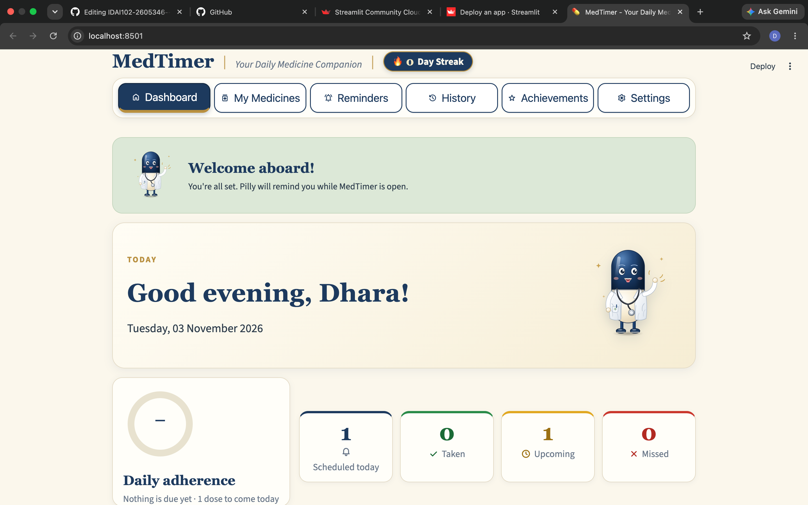
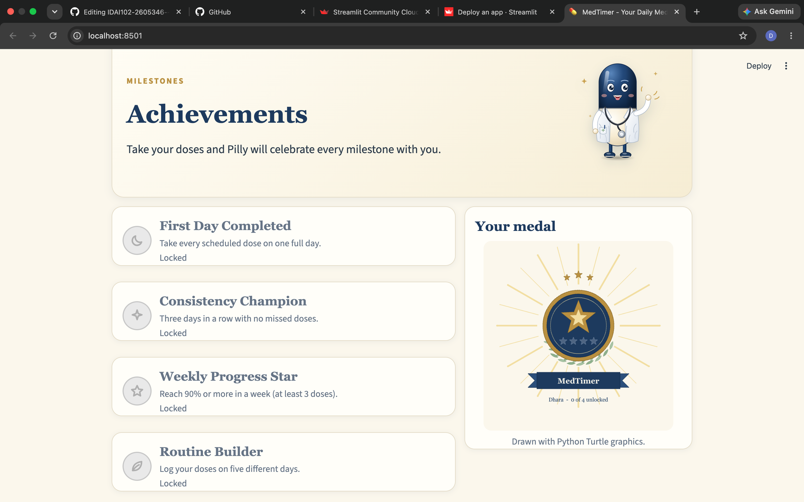
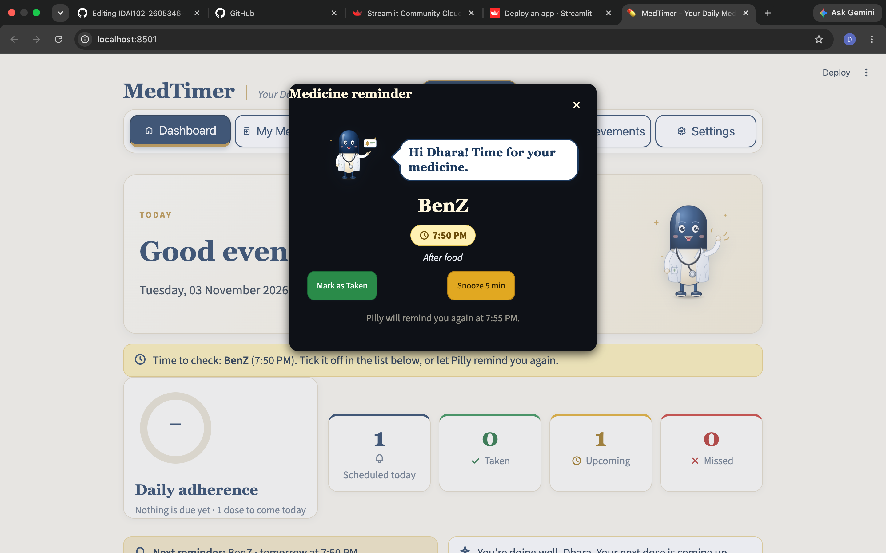
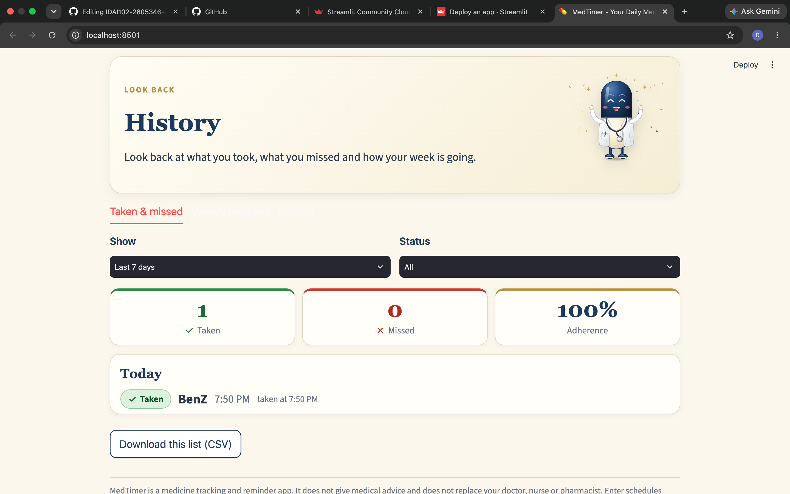
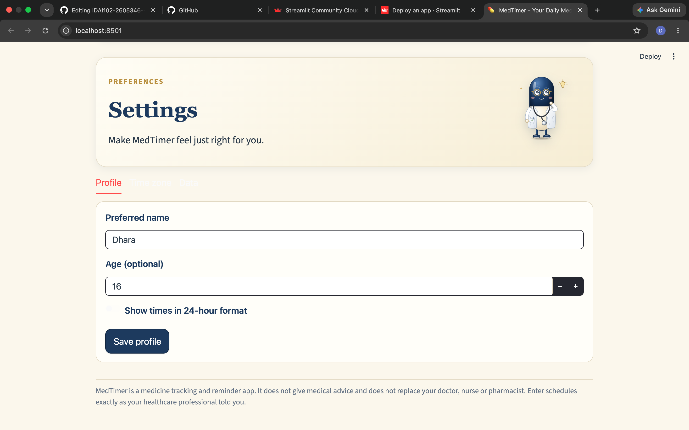

# IDAI102-2605346--DharaPatel.
A Python-based medicine reminder and tracking app built with Streamlit. Manage medicine schedules, receive timely reminders, track doses, and monitor weekly progress with a personalised interface.

# 💊 MedTimer – Smart Medicine Reminder Application

## 1. What Does the App Do?

MedTimer is a Python-based medicine reminder and tracking application developed using Streamlit. It is designed to help users organise their medicine schedules, receive timely reminders, record their doses, and monitor their progress.

The application provides a personalised experience from the moment a user opens it. Through a simple onboarding process and an interactive dashboard, users can manage their medicine routines and keep track of their schedules in one place.

MedTimer also features a friendly pill mascot named **Pilly**, making the application more engaging and welcoming.

## 2. Application Flow and Key Features

### 1. Welcome Screen
When users open MedTimer, they are welcomed by Pilly, the application's pill mascot. The welcome screen introduces the application and guides users through the initial setup process.

### 2. Personalised Onboarding
The application asks users to enter their name to create a personalised experience. Their name is then used throughout the application.

### 3. Medicine and Reminder Setup
After entering their name, users provide details about their medication and set up their reminder schedule.

During this process, users can:
- Enter the name of their medication.
- Specify when they need to take their medicine.
- Set the required reminder timings.
- Choose their preferred snooze duration.
- Configure the relevant medicine schedule details.

This initial setup helps the application organise reminders according to the information provided by the user.

### 4. Main Dashboard
Once the initial setup is complete, users are taken to the main dashboard.

The dashboard acts as the central space of MedTimer, bringing together important medicine information, upcoming schedules, and dose-tracking details.

### 5. Medicine Reminders
MedTimer provides reminder popups according to the schedules entered by the user.

The reminder system includes:
- Popup notifications for scheduled doses.
- Sound notifications to make reminders noticeable.
- Snooze functionality.
- Reminder volume settings.

Users can respond to reminders and keep track of their scheduled doses.

### 6. Dose Tracking and Medicine History
Users can mark scheduled doses as taken or missed. The application maintains medicine records so users can review their previous activity.

The history section also provides a weekly progress overview, helping users monitor their medicine schedules.

### 7. Achievements and Progress
MedTimer includes an achievement system that makes tracking progress more interactive. Users can view their achievements and monitor their progress through the application.

### 8. Settings and Data Management
The settings section allows users to manage available application preferences, reminder settings, and data-related options.

Users can also generate and download medicine records in CSV format for convenient reference.

## 3. Live Web App Link and Screenshots

### 🌐 Live Application

**Live App Link:**  
[Open MedTimer]medtimerpy-jjxjyd5a83dnbgbyp3urt8

### 📸 Application Screenshots

The following screenshots demonstrate the main interfaces and features of MedTimer.

#### 1. Main Dashboard
A view of the dashboard displaying the user's medicine information and tracking details.

#### 2. Achievements
A look at the achievement section, where users can view their progress.

#### 3. Medicine Reminders
A view of the reminder popup, showing how users are notified about their scheduled medication.

#### 4. Medicine History
A view of the medicine history and weekly progress section.

#### 5. Settings
A view of the settings section, where users can manage application preferences.

---

**Note:** MedTimer is an educational medicine-tracking and reminder application. It does not provide medical advice or replace instructions from healthcare professionals. Reminders operate while the application is running and the browser remains open.

